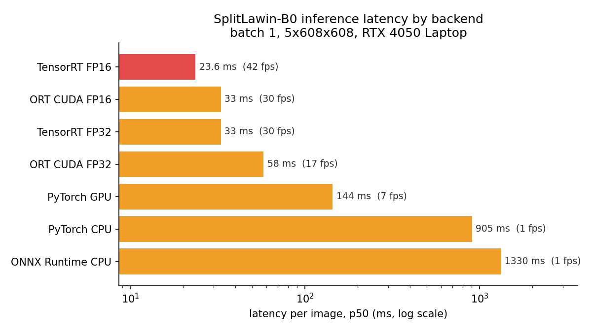
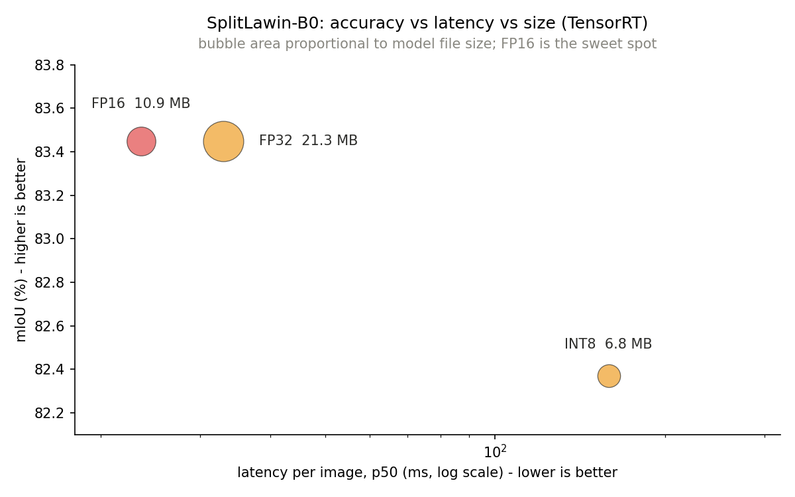

# SplitLawin Edge Deployment

Taking a lightweight multispectral crop/weed segmentation model (SplitLawin) and proving,
with real numbers, that it is fast and small enough for on board, real time inference.

This turns a thesis claim ("the model is lightweight and real time") into evidence: the trained
model is exported and optimized through PyTorch, ONNX, ONNX Runtime and TensorRT, at FP32, FP16
and INT8, and benchmarked for latency, accuracy and size on a consumer GPU and CPU.

> This is an educational portfolio project, shared to document the work and the results.

## Headline results

On an NVIDIA RTX 4050 Laptop GPU, batch 1, 5 band input at 608x608:

- **23.6 ms per frame (about 42 FPS) with TensorRT FP16**, down from 905 ms on CPU and 144 ms with
  plain PyTorch GPU. About a 38x speedup over CPU and 6x over naive GPU.
- **FP16 is free**: identical mIoU to FP32 (83.45%) at 1.75x the speed and half the file size.
- **7x smaller than the DeepLabV3+ baseline** (5.46M vs 39.76M parameters, 21 MB vs 159 MB), at
  comparable latency and slightly higher accuracy.

## The model

SplitLawin B0: a MiT-B0 (SegFormer) encoder with a Lawin decoder, an ASVF input module and a
Bottleneck SCSA attention block. Input is 5 bands (CIR + Blue + RedEdge), output is 3 classes
(background, crop, weed). 5.46M parameters, reaching **83.4% mIoU** on the WeedsGalore test set.

## Results

### Latency (SplitLawin B0, p50, batch 1, 608x608, RTX 4050)

| Backend | p50 latency | throughput |
|---|---|---|
| ONNX Runtime CPU | 1330 ms | 0.8 FPS |
| PyTorch CPU | 905 ms | 1.1 FPS |
| PyTorch GPU | 144 ms | 6.9 FPS |
| ONNX Runtime CUDA FP32 | 58 ms | 17 FPS |
| ONNX Runtime CUDA FP16 | 33 ms | 30 FPS |
| TensorRT FP32 | 33 ms | 30 FPS |
| **TensorRT FP16** | **23.6 ms** | **42 FPS** |

### Precision trade off (TensorRT, SplitLawin B0)

| Precision | mIoU | model size | latency |
|---|---|---|---|
| FP32 | 83.45% | 21.3 MB | 33 ms |
| **FP16** | **83.45%** | **10.9 MB** | **23.6 ms** |
| INT8 | 82.37% | 6.8 MB | 159 ms (see note) |

### SplitLawin vs DeepLabV3+ baseline

| | SplitLawin (this work) | DeepLabV3+ baseline |
|---|---|---|
| Parameters | 5.46M | 39.76M (7.3x) |
| ONNX size | 21.3 MB | 159 MB (7.5x) |
| mIoU (WeedsGalore test, 3 class) | 83.4% | 82.9% |
| Latency, ONNX Runtime CUDA FP32 | 58 ms | 80.6 ms |
| Latency, TensorRT FP16 | 23.6 ms | 24.6 ms |

## Honest findings

- **FP16 is the sweet spot.** Same accuracy as FP32, 1.75x faster, half the size. Essentially free.
- **INT8 did not pay off here.** It is 3x smaller, but it costs about 1.1 mIoU points (concentrated
  in the hard crop and weed classes), and through the ONNX Runtime QDQ path it was actually slower on
  TensorRT (reformatting overhead between int8 and fp16 regions). FP16 was the right choice.
- **Parameter count is not latency.** The DeepLabV3+ baseline has 7x more parameters but almost the
  same latency, because its plain convolutions are extremely well optimized by cuDNN and TensorRT,
  while SplitLawin uses transformer attention that is less hardware efficient at high resolution.
  Fewer FLOPs do not translate linearly into speed.
- **Where SplitLawin wins is footprint**: 7x smaller model, less compute, less memory and less energy
  per inference, which is what matters for storage and battery limited edge devices. On a weaker,
  memory bound device (for example a Jetson) the small model would likely also be faster, but that
  was not measured here, so it is stated as an expectation, not a result.

## Methods (summary)

The trained PyTorch model is exported to ONNX and checked for numerical parity (identical argmax on
every pixel). It is then benchmarked across backends and precisions, reporting p50 and p95 latency
with warmup iterations discarded and GPU synchronization for correct timing. Accuracy (mIoU, macro
over 3 classes) is measured on the WeedsGalore test set; INT8 is calibrated on held out validation
images, not the test set, to avoid data leakage. All measurements use batch 1 at 608x608 on an
RTX 4050 Laptop GPU. The SplitLawin mIoU is measured here; the baseline mIoU is the thesis reported
value.

## Attribution

- Encoder: SegFormer / MiT-B0 (Xie et al.).
- Decoder: Lawin (Yan et al.).
- SCSA attention: Si et al.
- ASVF input module: own contribution (Panagiotis Stamatis).
- Dataset: WeedsGalore (Celikkan et al., WACV 2025), CC BY. The dataset is not redistributed here.

## License

MIT, see [LICENSE](LICENSE). The upstream model and dataset keep their original licenses.
